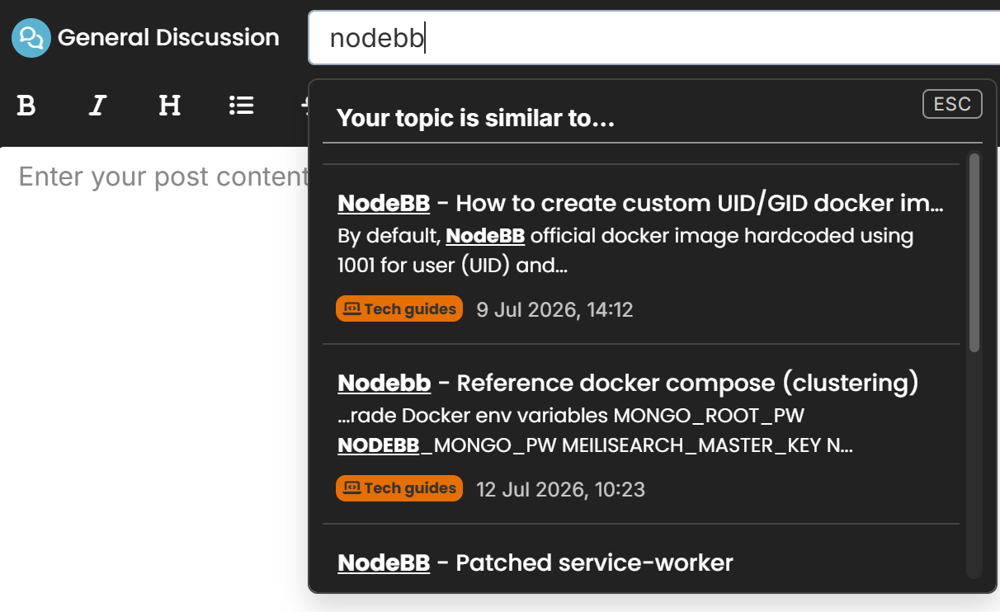
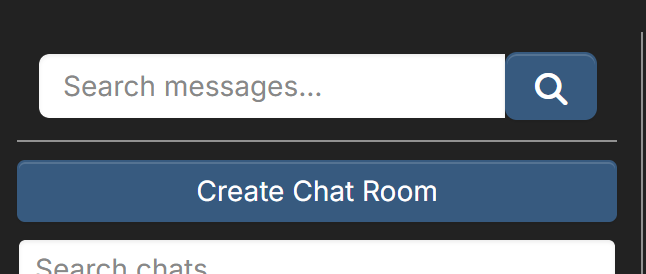
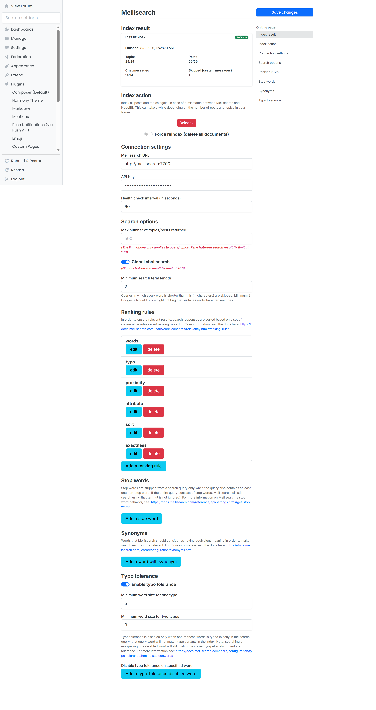

# Meilisearch Plugin for NodeBB (Refactored)
A plugin for integrating MeiliSearch with NodeBB (This plugin is inspired and refactored from the original [nodebb-plugin-meilisearch](https://github.com/oplik0/nodebb-plugin-meilisearch))

***__Make sure to disable nodebb-plugin-dbsearch when using this plugin.__***

**Required existing Meilisearch instance. Set your URL and API Key in the ACP**

- Refactored for NodeBB 4.14 up.
- Updated to Meilisearch JS API 0.59.
- ACP panel comply to NodeBB standard.
- Reindex / Force reindex all working as expected
- Composer suggestion optimization.
- Bug fixes from existing plugin.
- Chat search support
- Global chat search support (will auto detect and override ```nodebb-plugin-chat-search```)
- Federated (ActivityPub) content support: remote posts, topics, and chat messages are indexed and searchable like local content. <ins>***In-topic federated posts only available in version 4.16.4+***</ins>
- Semantic / hybrid (AI) search via Meilisearch embedders, configurable from the ACP (OpenAI, Hugging Face, Ollama, or a custom REST embedding endpoint). Requires a Meilisearch instance with embedder support (v1.13+).

\
<ins>**Composer suggestions**</ins>
\


<ins>**Global search**</ins>
\


<ins>**ACP**</ins>
\


<ins>**Federation notes**</ins>

Remote (federated) content is handled transparently:

- Remote posts carry URL-shaped pids, which Meilisearch rejects as primary keys — they are indexed under a reversible codec form (`apm_` + base64url) and decoded back to real pids on every search path (same mechanism the chat index already used for federated mids).
- Remote topics get locally-generated UUID tids, which are valid Meilisearch identifiers — no codec needed; they are filterable, so normal search and `postedBy` filtering work for federated users.
- Remote categories carry URL cids (`categoryRemote:<url>`); category filters emit them as quoted string literals, so searching within a remote category scopes correctly. Unclassified remote content lives in the world pseudo-category (cid −1) and matches the bare numeric filter.
- The reindex iterates the local and remote zsets (`posts:pid`/`postsRemote:pid`, `topics:tid`/`topicsRemote:tid`) as one merged loop per type, with progress totals covering both.
- After deploying onto a forum that already has federated content, run one force reindex to backfill remote documents.
